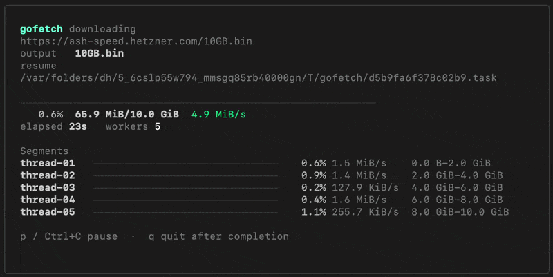

<h1 align="center">Gofetch</h1>

<p align="center">Segmented, resumable download manager for the terminal, written in Go.</p>

<p align="center">
  <a href="https://github.com/hackerslash/gofetch/releases/latest"></a>
  <a href="https://github.com/hackerslash/gofetch/actions/workflows/release.yml"></a>
  
  
</p>

Gofetch downloads files over HTTP with several concurrent workers, splitting the file into byte ranges when the server allows it. Downloads can be paused and resumed, and it can also mirror a static site or benchmark a set of mirrors.



## Features

- Concurrent downloads with a configurable worker count
- Segmented `Range` downloads when the server supports byte ranges
- Live terminal UI with total progress, per-segment progress and speed
- Pause with `p` or `Ctrl+C`, resume later from the printed task file
- Temp `.task` and part files live in the OS temp dir and are removed on success
- Batch downloads from a URL list file
- Same-host static mirroring (HTML, CSS, JS, images, fonts, linked assets)
- Mirror benchmarking ranked by latency and throughput

## Install

Download a binary for macOS, Linux or Windows from [Releases](https://github.com/hackerslash/gofetch/releases/latest) (`checksums.txt` included), or build from source with Go 1.25+:

```bash
go build -o gofetch ./cmd/gofetch
```

## Usage

```bash
gofetch get https://example.com/file.zip                  # single file
gofetch get https://example.com/file.zip --workers 10     # more workers (default 4)
gofetch get urls.txt --workers 10 --output downloads      # URL list into a directory
gofetch resume <path/to/id.task>                           # continue a paused download
gofetch mirror https://example.com --depth 2 --workers 8 --output mirror
gofetch bench https://mirror1.example/file https://mirror2.example/file --samples 3
gofetch clean                                              # delete all paused download state
```

| Command | Flags |
|---|---|
| `get <url\|file>` | `--workers` (4), `--output` (file path for one URL, directory for a list) |
| `mirror <url>` | `--workers` (4), `--depth` (2), `--output` (`mirror`) |
| `bench <url>...` | `--samples` (1) |
| `resume <task>` | |
| `clean` | |

A URL list has one URL per line; blank lines and lines starting with `#` are skipped.

During `get` or `resume`, press `p` or `Ctrl+C` to pause. The UI prints the exact `gofetch resume ...` command to continue.

## Development

```bash
go run ./cmd/gofetch --help
go test ./...
```

Tests use local HTTP test servers. In sandboxed environments, point `GOCACHE` (and `GOMODCACHE` if needed) at a writable directory.

Pushing a `v*` tag runs [`release.yml`](.github/workflows/release.yml), which builds darwin/linux (amd64, arm64) and windows/amd64 binaries and publishes them with checksums.

Built with [Bubble Tea](https://github.com/charmbracelet/bubbletea) and [Lip Gloss](https://github.com/charmbracelet/lipgloss).
